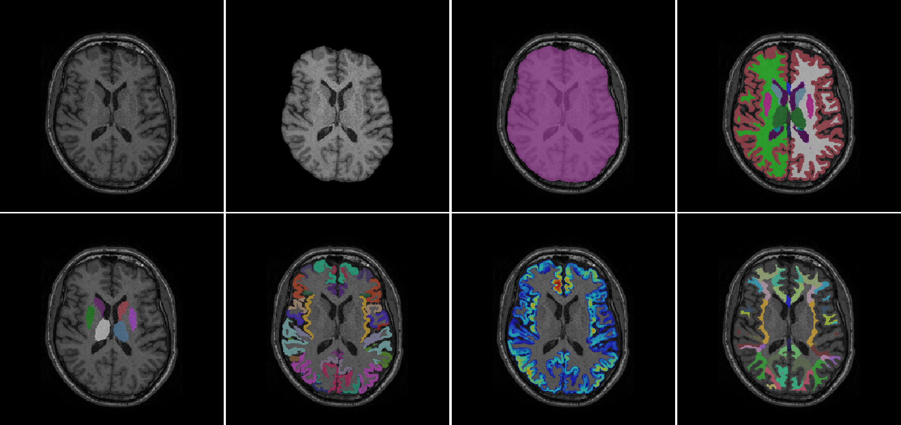

# TigerBx: Tissue Mask Generation for Brain Extraction


## Overview

**TigerBx** is a deep learning toolkit for brain extraction and tissue segmentation. It provides:

* Pretrained models for structural brain segmentation.
* A stand-alone executable (rustbx: tBET, ASEG, template normalisation) for Windows, macOS, and Linux.
* Python APIs for advanced users and scripting.
* Designed strictly for **research purposes only**—not for clinical or commercial use.



---

## License

TigerBx, including the model weights it downloads, is licensed under the **Creative Commons Attribution-NonCommercial-ShareAlike 4.0 International (CC BY-NC-SA 4.0)** license. Commercial use is not permitted, and adaptations must be shared under the same license. See `LICENSE` for details.

## Quick Start

### Install as a Python package

```bash
# CPU runtime
pip install --no-cache-dir "tigerbx[cpu] @ https://github.com/htylab/tigerbx/archive/release.zip"

# GPU runtime (CUDA 12)
pip install --no-cache-dir "tigerbx[cu12] @ https://github.com/htylab/tigerbx/archive/release.zip"
```

```python
import tigerbx

# Brain mask + brain image + ASEG + deep gray matter (recommended)
tigerbx.run('bmad', 'T1w.nii.gz', 'output_dir')
```

### Install a specific version

```bash
pip install --no-cache-dir "tigerbx[cpu] @ https://github.com/htylab/tigerbx/archive/refs/tags/v0.3.0.tar.gz"
pip install --no-cache-dir "tigerbx[cu12] @ https://github.com/htylab/tigerbx/archive/refs/tags/v0.3.0.tar.gz"
```

> **Note:** To install an archived version in the **0.1.x** series, use the simpler URL form (no extras required):
> ```bash
> pip install https://github.com/htylab/tigerbx/archive/refs/tags/v0.1.20.tar.gz
> ```

---

## Modules

### `bx` — Brain Extraction and Segmentation

```python
import tigerbx

# Brain mask + brain image + ASEG + deep gray matter (recommended)
tigerbx.run('bmad', 'T1w.nii.gz', 'output_dir')

# Full pipeline — all output types
tigerbx.run('bmacdC', 'T1w.nii.gz', 'output_dir')

# Process a directory; outputs saved next to each input file
tigerbx.run('bm', '/data/T1w_dir')

# GPU inference
tigerbx.run('bmadg', '/data/T1w_dir', '/data/output')
```

```bash
tiger bx T1w.nii.gz -bmad -o output_dir
tiger bx T1w.nii.gz -bmacdC -o output_dir
tiger bx /data/T1w_dir -bmadg -o /data/output
```

See [bx usage](doc/bx.md) for a complete flag reference and output file naming.

---

### `hlc` — Hierarchical Label Consolidation

Maps FreeSurfer-style labels to 56 hierarchical regions. Also produces cortical thickness and CSF/GM/WM probability maps.

The HLC module was developed by **Pin-Chuan Chen**.

```python
import tigerbx

# Default: HLC parcellation only
tigerbx.hlc('T1w.nii.gz', 'output_dir')

# All outputs (brain mask, bet, HLC, cortical thickness, CSF/GM/WM)
tigerbx.hlc('T1w.nii.gz', 'output_dir', save='all')

# Cortical thickness + tissue probability maps with GPU
tigerbx.hlc('T1w.nii.gz', 'output_dir', save='tcgw', GPU=True)
```

```bash
tiger hlc T1w.nii.gz -o output_dir
tiger hlc T1w.nii.gz --save all -o output_dir
tiger hlc T1w.nii.gz --save tcgw -g -o output_dir
```

See [HLC usage](doc/hlc.md) for a complete description.

---

### `reg` — Registration

Supports affine (numreg / C2FViT), VFA and VMnet registration.
The default and recommended plan is `AD` (numreg affine + VFA).
High-level workflows such as VBM are documented separately under
[pipeline usage](doc/pipelines.md).

The registration pipeline was developed by **Pei-Mao Sun**.

```python
import tigerbx

# Affine registration (numreg)
tigerbx.reg('A', r'C:\T1w_dir', r'C:\output_dir')

# Affine + VFA nonlinear registration (recommended)
tigerbx.reg('AD', r'C:\T1w_dir', r'C:\output_dir')

# Affine (C2FViT) + VMnet nonlinear registration
tigerbx.reg('AV', r'C:\T1w_dir', r'C:\output_dir', affine_type='C2FViT')

# Affine + VFA, saving the warp field for tigerbx.transform
tigerbx.reg('AD', r'C:\T1w_dir', r'C:\output_dir', save_displacement=True)

# Apply a saved warp field to a label map
tigerbx.transform(r'C:\moving.nii.gz', r'C:\warp.npz', r'C:\output_dir',
                  interpolation='nearest')
```

```bash
tiger reg A T1w.nii.gz -o output_dir
tiger reg AD T1w.nii.gz -o output_dir
tiger reg AD T1w.nii.gz -o output_dir --save_displacement
```

See [registration usage](doc/reg.md) for detailed usage.

---

### `pipelines` — High-Level Workflows

Use `tigerbx.pipeline(name, ...)` for opinionated multi-stage workflows.
Currently, TigerBx exposes the `vbm` pipeline through the dispatcher, a Python
alias, and a dedicated CLI subcommand.

```python
import tigerbx

# Recommended dispatcher entry point
tigerbx.pipeline('vbm', r'C:\T1w_dir', r'C:\output_dir')

# Convenience alias
tigerbx.vbm(r'C:\T1w_dir', r'C:\output_dir')

# Customize the registration stage used inside the pipeline
tigerbx.pipeline('vbm', r'C:\T1w_dir', r'C:\output_dir',
                 reg_plan='AV', affine_type='C2FViT')
```

```bash
tiger vbm /data/T1w_dir -o /data/output
tiger vbm /data/T1w_dir -o /data/output --reg-plan AV --affine_type C2FViT
```

Each input gives `_SmoothedGM` (modulated, smoothed GM in template space) and `_norm`; `vbm_summary.csv` lists
TIV, GM / WM / CSF volumes, image-quality measures and QC flags (batch outliers) per input. A failing input is logged and skipped.

See [pipeline usage](doc/pipelines.md) for dispatcher and VBM details.

---

### `gdm` — Generative Displacement Mapping

Corrects geometric distortions in EPI scans using a GAN-based displacement field predictor, without requiring field maps or reversed-phase-encode acquisitions [Kuo et al., 2025].

```python
import tigerbx

# Correct a single DTI file
gdm_result = tigerbx.gdm('dti.nii.gz', 'output_dir')
# Single input: {'gdmi': nibabel_image}

# Specify b0 index or .bval file
tigerbx.gdm('dti.nii.gz', 'output_dir', b0_index=1)
tigerbx.gdm('dti.nii.gz', 'output_dir', b0_index='dti.bval')

# Save displacement map with GPU
tigerbx.gdm('dti.nii.gz', 'output_dir', dmap=True, GPU=True)
```

```bash
tiger gdm dti.nii.gz -o output_dir
tiger gdm dti.nii.gz -b0 1 -o output_dir
tiger gdm dti.nii.gz -b0 dti.bval -o output_dir
tiger gdm dti.nii.gz -m -g -o output_dir
```

See [GDM usage](doc/gdm.md) for a complete description.

---

### `embed` — VFA Brain Embedding

Regional features for downstream models: the mean VFA encoder feature in each of 37 ASEG structures
(`[37, 96]` per image), with structure volumes, TIV and image-quality measures, in one `<stem>_embed.npz`.

```python
import tigerbx
tigerbx.embed(r'C:\T1w_dir', r'C:\output_dir')
```

```bash
tiger embed /data/T1w_dir -o /data/embed_out
```

See [embed usage](doc/embed.md) for the file layout, how to use the features and validation.

---

### `eval` — Image Quality and Segmentation Metrics

Computes quantitative metrics between a ground-truth and a predicted image.
Accepts NIfTI file paths, nibabel images, or numpy arrays.

```python
import tigerbx

# Segmentation — evaluate ASEG prediction against ground truth
result = tigerbx.run('a', 'T1w.nii.gz', 'output/')
scores = tigerbx.eval('gt_aseg.nii.gz', result['aseg'], 'dice',
                      labels=[10, 11, 17, 18])
# → {'dice': {'10': 0.91, '11': 0.89, '17': 0.94, '18': 0.92, 'mean': 0.915}}

# Multiple metrics at once
scores = tigerbx.eval('gt.nii.gz', 'pred.nii.gz', ['dice', 'hd95'],
                      labels=[1, 2, 3])

# Reconstruction quality (e.g. after GDM)
scores = tigerbx.eval('ref.nii.gz', 'pred_gdm.nii.gz', ['psnr', 'ssim', 'ncc'])
```

Supported metrics: `dice`, `iou`, `hd95`, `asd`, `mae`, `mse`, `psnr`, `ssim`, `ncc`, `mi`, `ksg_mi`, `accuracy`, `precision`, `recall`, `f1`.

See [eval usage](doc/eval.md) for the full API reference and examples.

---

## Agent Skills (Claude Code / Codex CLI)

TigerBx ships a skill for AI coding assistants. Just ask Claude Code or Codex:

```
Install the tigerbx skill from https://github.com/htylab/tigerbx/tree/main/skills/tigerbx
```

After that the assistant knows when and how to use the TigerBx API and CLI.

---

## Installation (stand-alone executable: rustbx)

`rustbx` is a native executable (no Python) for tBET, ASEG and template normalisation with the same models.
Download the zip for Linux (x64, glibc 2.28+), macOS (arm64) or Windows (x64) from
[https://github.com/htylab/tigerbx/releases](https://github.com/htylab/tigerbx/releases) and unpack it; keep the
files together (Linux / macOS: the ONNX Runtime library next to `rustbx`).

```bash
rustbx T1w.nii.gz                 # _tbet
rustbx data/ -o out/ --seg        # _tbet, _aseg
rustbx data/ -o out/ --norm       # _tbet, _norm (template space, tissue-normalised)
rustbx data/ -o out/ --all        # _tbet, _aseg, _norm
rustbx --help
```

The other modules (`hlc`, `reg` options, `vbm`, `embed`, `gdm`, GPU) are in the Python package (`tiger` CLI
above). See [rust/README.md](rust/README.md) for details.

---

## Supported Platforms

* Windows and macOS
* Ubuntu 20.04 or newer

---

## Citation

If you use TigerBx in your research, please cite the following:

1. **Weng JS, et al.** (2022) *Deriving a robust deep-learning model for subcortical brain segmentation by using a large-scale database: Preprocessing, reproducibility, and accuracy of volume estimation.* **NMR Biomed. 2022; e4880.** https://doi.org/10.1002/nbm.4880

2. **Wang HC et al.** (2024) *Comparative Assessment of Established and Deep Learning Segmentation Methods for Hippocampal Volume Estimation in Brain MRI Analysis.* **NMR in Biomedicine; e5169.** https://doi.org/10.1002/nbm.5169

3. **Kuo CC, et al.** (2025) *Referenceless reduction of spin-echo echo-planar imaging distortion with generative displacement mapping.* **Magn Reson Med.** 2025; 1–16. https://doi.org/10.1002/mrm.30577

4. **Sun PM, et al.** (2026) *DeepVBM: A fully automatic and efficient voxel-based morphometry via deep learning-based segmentation and registration methods.* **Magn Reson Imaging. 2026; 128: 110637.** https://doi.org/10.1016/j.mri.2026.110637

---

## Label Definitions

See [Label definitions](doc/seglabel.md) for a full list of anatomical regions used in segmentation outputs.

---

## Validation and Benchmarks

See [Validation](doc/validation.md) for accuracy, reproducibility, and comparison against other tools.

---

## Contributing

Contributions are welcome! See the [Developer Guide](doc/developer_guide.md) for instructions on setting up a local environment, branch and commit conventions, running tests, and submitting pull requests.

---

## Disclaimer

This software is intended solely for **research use** and has **not** been reviewed or approved by the FDA or any regulatory body. It must **not** be used for diagnostic, treatment, or other clinical purposes.

The software is provided **"as is"**, without warranty of any kind. The developers assume no responsibility for any consequences arising from the use of this software.
